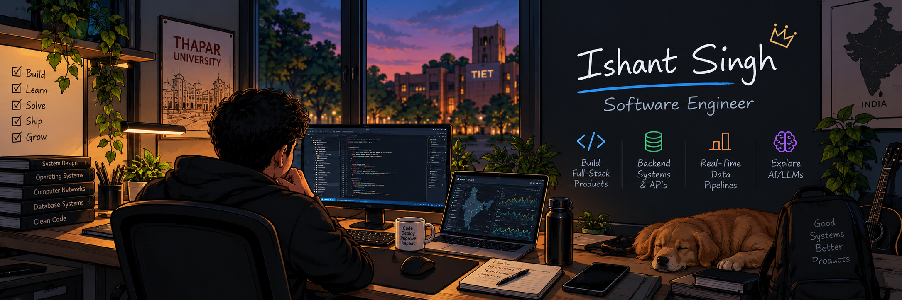
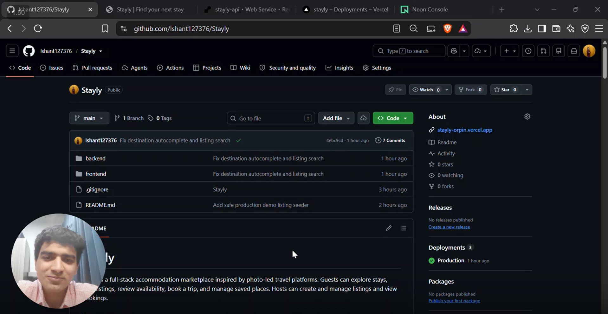
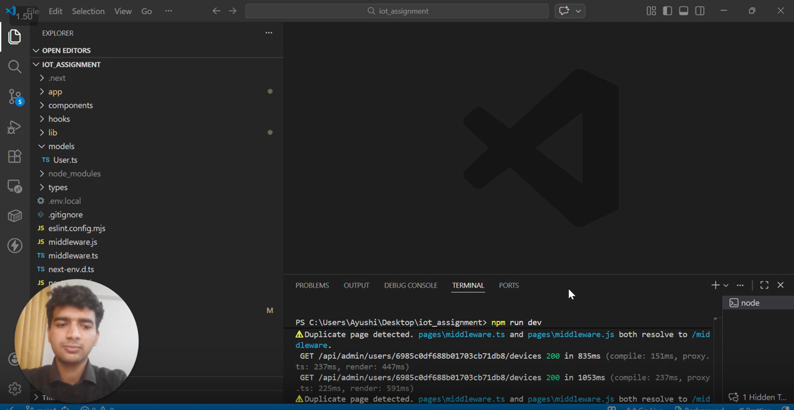

# Hey, I'm Ishant Singh 👋

### Software Engineer in the Making · CSE @ TIET

Building web applications, backend systems, and practical software solutions.

---

## SELECTED WORK

<table>
<tr>
<td width="50%" valign="top">

### 🏡 Stayly

A full-stack accommodation booking application inspired by Airbnb.

- Listing discovery and property details
- Booking lifecycle and trip management
- Host dashboard and listing management

**Stack**

`Next.js` `TypeScript` `Tailwind CSS` `FastAPI` `SQLite` `SQLAlchemy`

[↗ View Repository]() · [▶ Watch Demo]()

</td>
<td width="50%" valign="top">

### ⚡ OJAS — Energy Monitoring

An IoT energy-monitoring platform for device management and live telemetry.

- MQTT-based telemetry pipeline
- Backend integration with MongoDB
- Python DLMS bridge with simulation support

**Stack**

`Node.js` `Express` `React` `MongoDB` `MQTT` `Python`

[↗ View Repository]() · [▶ Watch Demo]()

</td>
</tr>
</table>

---

## TECH STACK

---

## EXPERIENCE

**Software Engineering Intern — Omkar Energy Solutions**

Working on backend development and software integrations, including Apple MFi software authentication and energy-monitoring systems.

---

### Always building. Always learning.

